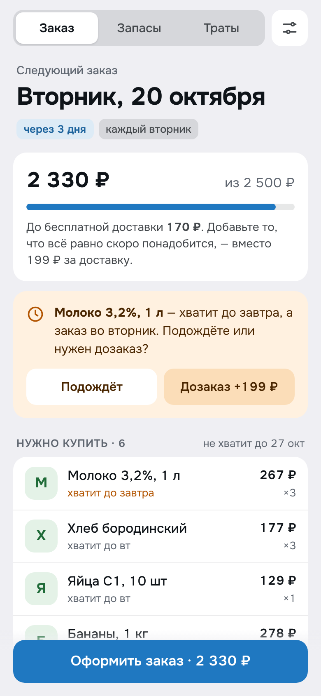
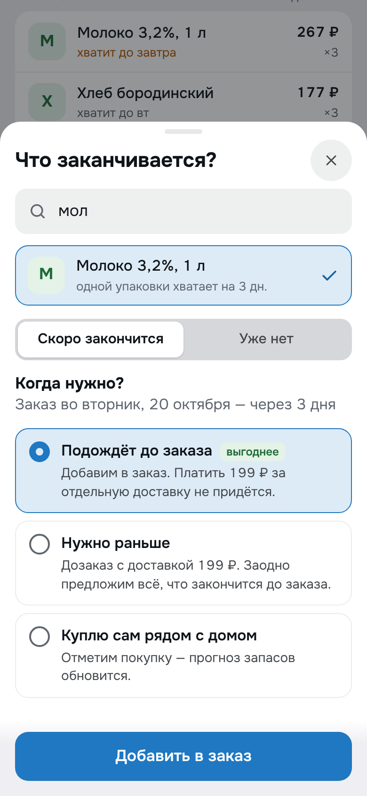
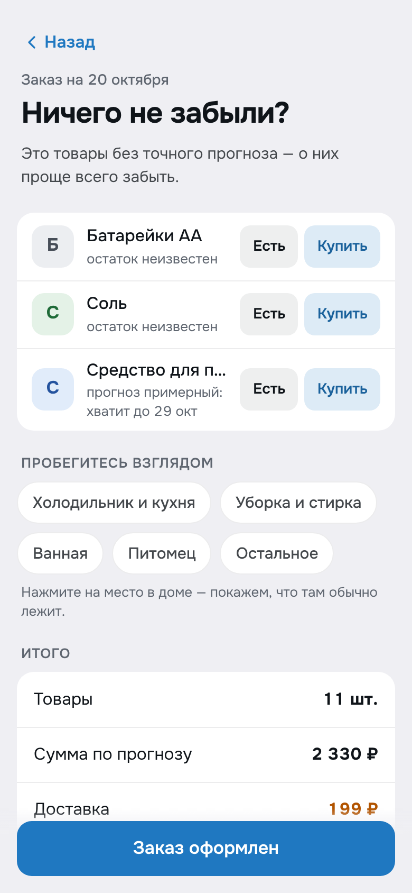
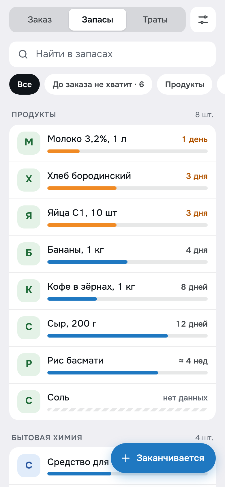
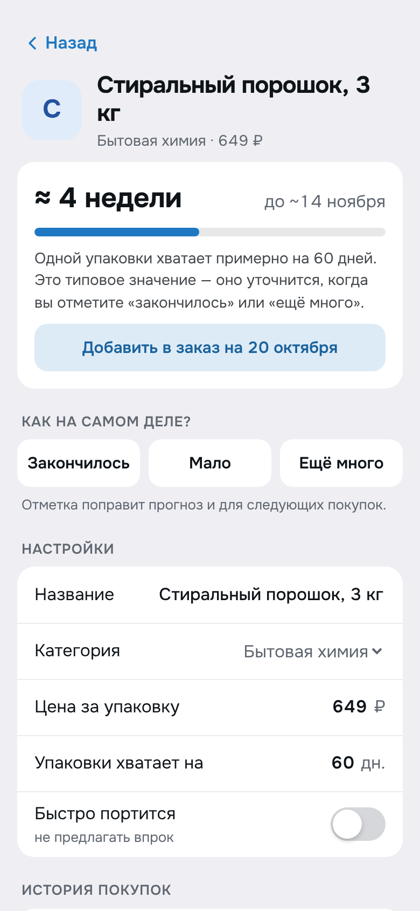
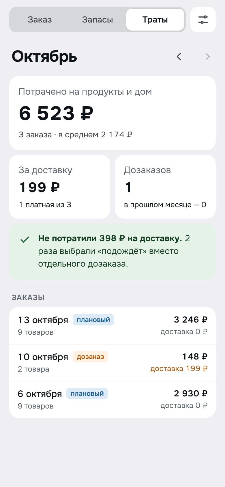

# Кладовка

Telegram Mini App для планирования закупок продуктов и товаров для дома.

Заказывайте раз в неделю и ничего не забывайте: приложение знает, на сколько хватает каждого товара,
и к дню заказа само собирает всё, чего не хватит **до следующего заказа**. Порошок, которого хватает на два месяца,
появится в списке ровно тогда, когда нужно. А если что-то закончилось раньше, приложение покажет, сколько стоит
дозаказ, и предложит подождать или сразу взять всё, что скоро понадобится.

| Заказ | Заканчивается | Ничего не забыли? | Запасы | Товар | Траты |
|---|---|---|---|---|---|
|  |  |  |  |  |  |

- [Продуктовая проработка](docs/PRODUCT.md): проблема, сценарии, алгоритм, метрики, roadmap.
- [Дизайн](docs/DESIGN.md): принципы, экраны, токены, ссылка на макеты.

## Как это работает

- У товара есть расход — «одной упаковки хватает на N дней» — и прогноз, когда он закончится.
- Товар попадает в заказ, если закончится раньше **следующего** заказа; количество считается так,
  чтобы его хватило до следующего заказа.
- Отметки «закончилось», «мало», «ещё много» и покупки уточняют расход.
- «Подождёт» вместо дозаказа засчитывается как сэкономленная доставка (не чаще раза за цикл).

Логика — чистые функции в [`src/model`](src/model), покрыта тестами.

## Запуск

```bash
npm install
npm run dev       # http://localhost:5173 — работает и в обычном браузере
npm test          # тесты логики и бота
npm run build     # сборка в dist/
```

Вне Telegram приложение использует localStorage и свою нижнюю кнопку, внутри Telegram — CloudStorage
(синхронизация между устройствами), нативные MainButton/BackButton, тему и вибрацию.
Чтобы быстро посмотреть приложение, нажмите «Посмотреть на примере» на первом экране.

## Подключение к Telegram

1. **Хостинг.** Mini App должен открываться по HTTPS. Проще всего GitHub Pages: workflow
   [`deploy.yml`](.github/workflows/deploy.yml) на каждый пуш в `main` собирает приложение и кладёт его в ветку
   `gh-pages`. Один раз включите *Settings → Pages → Source: Deploy from a branch → `gh-pages` / (root)* —
   приложение появится по адресу `https://<user>.github.io/<repo>/`. Для приватного репозитория Pages доступен
   на платных планах GitHub; на бесплатном сделайте репозиторий публичным (секретов в нём нет).
2. **Бот.** В [@BotFather](https://t.me/BotFather): `/newbot` → получите токен; `/newapp` (или *Bot Settings → Menu Button*)
   → укажите URL из шага 1. Этого достаточно, чтобы приложение открывалось из бота.
3. **Напоминания (по желанию).** Mini App не может сам слать уведомления, поэтому есть маленький сервер
   [`bot/server.mjs`](bot/server.mjs) без зависимостей:

   ```bash
   BOT_TOKEN=123:abc WEBAPP_URL=https://<user>.github.io/<repo>/ PORT=8080 npm run bot
   ```

   Он отвечает на `/start` кнопкой открытия, ставит кнопку меню и пишет накануне вечером (20:00) и утром в день
   заказа (10:00) по часовому поясу пользователя. Разверните его на любом хостинге с HTTPS (Render, Fly.io, VPS)
   и соберите Mini App с адресом сервера: `VITE_API_URL=https://bot.example.com npm run build`
   (для GitHub Pages — переменная репозитория `VITE_API_URL` в *Settings → Secrets and variables → Actions → Variables*).
   Сервер проверяет подпись `initData`, данные хранит в `bot/data.json`.

## Структура

```
src/
  model/        типы, расчёт плана (forecast.ts), действия (actions.ts), каталог, пример данных
  telegram/     обёртка WebApp, MainButton, хранилище (CloudStorage + localStorage)
  screens/      экраны и шторки
  ui/           общие компоненты
  state.tsx     состояние и сохранение
  nav.tsx       навигация, BackButton, тосты
bot/            бот-сервер напоминаний
docs/           продукт, дизайн, скриншоты
```
